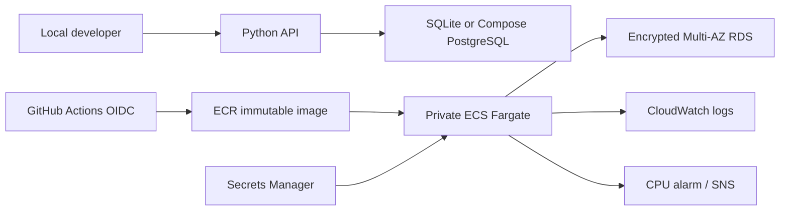

# AP Controls Platform

A hands-on Senior DevOps portfolio project inspired by the Xelix role. Independently built; not affiliated with Xelix. Uses synthetic invoices only.

## Run in 60 seconds

Requires Python 3.13. From this directory:

```powershell
python -m unittest discover -s tests -v
python -m app.server
```

In another PowerShell window:

```powershell
Invoke-RestMethod http://localhost:8080/ready
$invoice = '{"vendor":"Acme","reference":"INV-001","amount":"12500.00"}'
Invoke-RestMethod http://localhost:8080/assess -Method Post -ContentType application/json -Body $invoice
```

First request flags `high_amount`; repeating it also flags `duplicate_reference`. Invoice references are normalized, monetary values use Decimal, and a database unique constraint prevents concurrent duplicate inserts. Currency is deliberately outside the demo scope; use one currency only.

For real PostgreSQL locally, install Docker and run `docker compose up --build`. Compose uses persistent PostgreSQL storage and a deliberately local-only password. The plain Python mode uses a local SQLite database and requires no packages.

## What is included

- Python HTTP API, validation, structured request logs, liveness and database readiness.
- Docker image running as a non-root user; local PostgreSQL Compose stack.
- Terraform: private ECS Fargate task, encrypted Multi-AZ PostgreSQL RDS, managed database secret, task IAM roles, security groups, CloudWatch logs, CPU alarm and email notification.
- GitHub Actions: Python tests, image build and Terraform validation; manual OIDC image publishing.
- Incident, database, deployment, security and ML operations guidance under `docs/`.



## AWS preparation and deployment

Terraform deployment is intentionally manual and incurs AWS charges. No infrastructure has been provisioned.

1. Supply an existing VPC with two private subnets in different availability zones. Tasks need outbound HTTPS through NAT or VPC endpoints for ECR API, ECR Docker, CloudWatch Logs, Secrets Manager, plus an S3 gateway endpoint for ECR layers. DNS resolution must work.
2. Create a private ECR repository named `ap-controls` with immutable tags and scan-on-push. Build and push the Docker image; record its digest.
3. Install Terraform >=1.10, authenticate to your AWS account, copy `infra/terraform.tfvars.example` to `infra/terraform.tfvars`, and replace every placeholder.
4. Run `terraform -chdir=infra init`, `terraform -chdir=infra fmt`, `terraform -chdir=infra validate`, then `terraform -chdir=infra plan -out=review.tfplan`. Review costs, security and resource names before running `terraform -chdir=infra apply review.tfplan`.
5. Confirm the SNS email subscription and inspect ECS health and logs. Access port 8080 only through a separately configured trusted private network path: the task security group intentionally has no inbound rule. There is no public endpoint.
6. After a deployment, update `image` to a new immutable digest and repeat plan/apply. ECS rolls back failed task deployments. Test readiness from inside your private network before allowing traffic.

For team use, configure an encrypted S3 Terraform backend with versioning, native state locking (`use_lockfile = true`) and restricted IAM before the first shared apply. This example defaults to local state. State and plan files can contain sensitive metadata; never commit them. Commit the generated provider lockfile after initialization and review.

## Scope and honest limitations

This is a portfolio starter, not a production-ready financial system. ECS/RDS have not been deployed or integration-tested here. Docker and Terraform checks require their external runtimes; see `VALIDATION.md`. The service uses Python's development-oriented standard-library HTTP server and has no authentication, rate limiting or TLS termination. Keep it private and use synthetic data.

The AWS demo uses the managed database owner credentials for bootstrap simplicity. Before production, run migrations separately, create a least-privilege application database role, and rotate/redeploy credentials. ECS injects a secret at startup; rotation needs a new task deployment. TLS uses `require`; configure an AWS RDS CA bundle and `verify-full` before production.

ECS is implemented; EKS is discussed as an architecture extension. Rule-based scoring is implemented, not a trained ML model. There is no automatic scaling, public ingress, production SLO instrumentation, compliance certification or claim of load-tested capacity. See `docs/OPERATIONS.md` for the concrete next steps.

## Sources

- [AWS provider documentation](https://registry.terraform.io/providers/hashicorp/aws/latest/docs)
- [ECS deployment circuit breaker](https://github.com/hashicorp/terraform-provider-aws/blob/main/website/docs/r/ecs_service.html.markdown)
- [GitHub OIDC with AWS](https://docs.github.com/en/actions/how-tos/secure-your-work/security-harden-deployments/oidc-in-aws)
